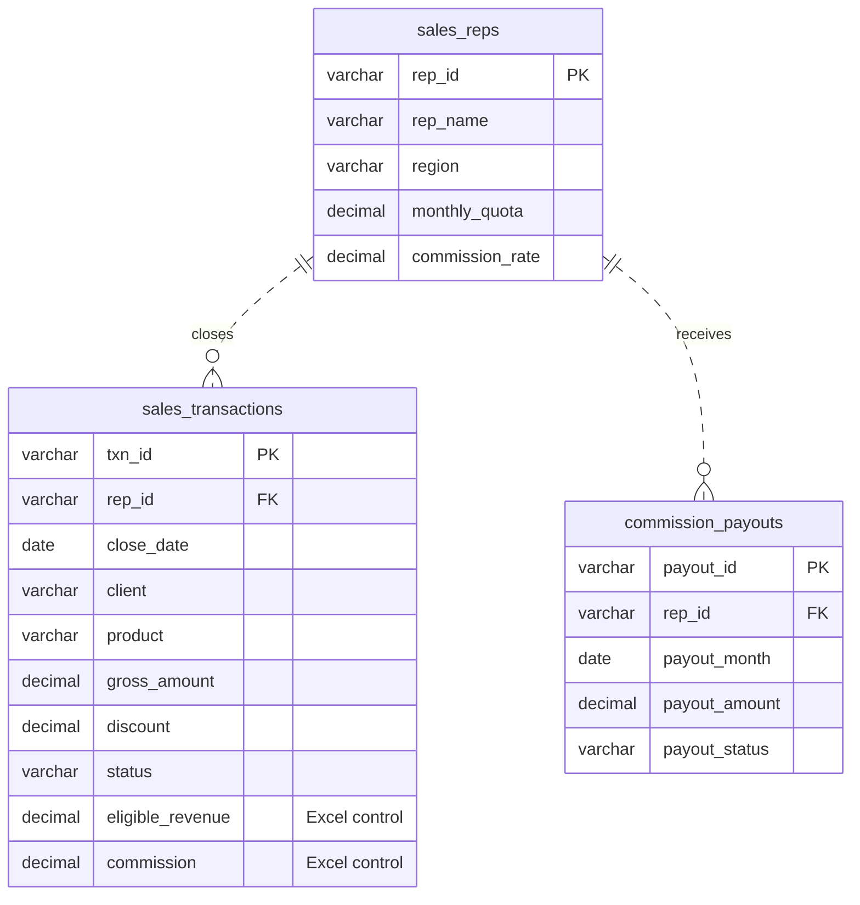

# ApexCloud | Sales Performance & Commission Analytics

**MySQL · Sales Performance Management · January–June 2025**

ApexCloud is a fictional B2B software company. This case study shows how Sales Operations can track quota attainment and how Finance can verify that each representative was paid the commission they earned.

**Dataset:** 12 representatives · 5 regions · 216 transactions · 72 monthly payout records

[Key findings](#key-findings) · [Data model](#data-model) · [SQL analyses](#sql-analyses) · [Run locally](#run-locally)

## Key findings

**North led sales.** ApexCloud won 179 deals and generated **₹3,95,50,225** in eligible revenue. North contributed 30.35% of that total, and February was the strongest month at ₹72.32 lakh. [Sales overview](queries/01_sales_overview.sql) · [Monthly results](queries/02_sales_performance.sql) · [Regional revenue share](queries/04_ranking_analysis.sql)

| Region | Eligible revenue | Share |
| --- | ---: | ---: |
| North | ₹120.05 lakh | 30.35% |
| South | ₹101.67 lakh | 25.71% |
| Central | ₹66.77 lakh | 16.88% |
| West | ₹54.71 lakh | 13.83% |
| East | ₹52.31 lakh | 13.22% |

**Revenue and commission had different leaders.** Aarav Mehta led eligible revenue at ₹41.95 lakh. Kabir Singh earned the most commission (₹1,73,318.63), with a 4.5% rate compared with Aarav’s 3.5%. [Representative analysis](queries/03_rep_analysis.sql)

**West was the only region below its combined quota.** It reached **82.52%** over six months and missed quota in 7 of its 12 rep-months. Across the company, 20 of 72 rep-months were below quota. [Quota attainment](queries/04_ranking_analysis.sql)

**Four settled payouts differed from commission earned.** Two were overpaid by ₹3,500 in total and two were underpaid by ₹5,000, for a net underpayment of ₹1,500 across settled payouts. A further ₹26,372.25 was pending. [Reconciliation query](queries/05_commission_reconciliation.sql)

| Period | Representative | Expected | Settled | Variance | Result |
| --- | --- | ---: | ---: | ---: | --- |
| Feb 2025 | Aarav Mehta | ₹26,880.00 | ₹29,280.00 | +₹2,400.00 | Overpaid |
| Mar 2025 | Vivaan Nair | ₹35,343.00 | ₹33,543.00 | −₹1,800.00 | Underpaid |
| Apr 2025 | Reyansh Shah | ₹7,392.00 | ₹4,192.00 | −₹3,200.00 | Underpaid |
| May 2025 | Kabir Singh | ₹26,372.25 | ₹0.00 | −₹26,372.25 | Pending payout |
| Jun 2025 | Meera Joshi | ₹23,872.63 | ₹24,972.63 | +₹1,100.00 | Overpaid |

## Data model



Each payout record represents one rep and calendar month. [Schema](schema.sql) includes the unique rep/month key and two views: `deal_financials` recalculates deal amounts, and `rep_month_performance` keeps every rep and reporting month visible, including those with no wins.

### Calculation rules

- **Eligible revenue:** Gross amount minus the rupee discount on won deals. Pending and cancelled deals contribute zero.
- **Earned commission:** Eligible revenue × the rep’s rate, rounded to two decimals per deal and summed by close month. Each rep’s rate and quota are fixed for this period. Refunds and later-period clawbacks are outside the case study.
- **Quota attainment:** Monthly eligible revenue ÷ monthly quota × 100. The status uses the underlying amounts, so a displayed value rounded to 100.00% can still be below quota.
- **Payout variance:** Settled payout minus earned commission. The query labels pending or missing payouts separately from settled discrepancies.

The [CSV files](data/) reuse the fictional representatives and transactions from the ApexCloud Excel portfolio. Workbook revenue and commission are retained as control values. Payouts are synthetic and include deliberately seeded exceptions.

## SQL analyses

| Queries | Business question | SQL techniques |
| --- | --- | --- |
| [01–04 · Sales overview](queries/01_sales_overview.sql) | Which deals were won, and what were they worth? | Filtering, sorting, `DISTINCT`, aggregates |
| [05–06 · Sales performance](queries/02_sales_performance.sql) | How did sales trend, and which regions cleared ₹50 lakh? | `GROUP BY`, joins, `HAVING` |
| [07–09 · Representative analysis](queries/03_rep_analysis.sql) | Who earned above average or recorded no wins? | Inner and left joins, CTE, subquery |
| [10–13 · Rankings and quota](queries/04_ranking_analysis.sql) | Who led each region, and who missed quota? | `DENSE_RANK`, `ROW_NUMBER`, window totals, `CASE` |
| [14 · Commission reconciliation](queries/05_commission_reconciliation.sql) | Which payouts need Finance to investigate? | Join on rep and month, `COALESCE`, `CASE` |
| [15 · Data validation](queries/06_data_validation.sql) | Do calculated values agree with Excel, and are any deals possible duplicates? | Comparison, `UNION ALL`, `HAVING` |

## Run locally

From the repository root, use **MySQL 8.0.16 or later** and an account that can create a fresh database. The setup uses [seed.sql](seed.sql), a SQL copy of the CSV snapshot.

```bash
mysql -u root -p -e 'CREATE DATABASE apexcloud_spm CHARACTER SET utf8mb4;'
mysql -u root -p apexcloud_spm < schema.sql
mysql -u root -p apexcloud_spm < seed.sql
mysql -u root -p apexcloud_spm < queries/05_commission_reconciliation.sql
```

Substitute any query file from the table above. On the supplied data, reconciliation returns **72 rows** (67 matched, 4 settled discrepancies, 1 pending) and validation returns **0 rows**. The sales totals match the Excel dashboard: **₹3,95,50,225** in eligible revenue and **₹15,54,940.43** in earned commission.
